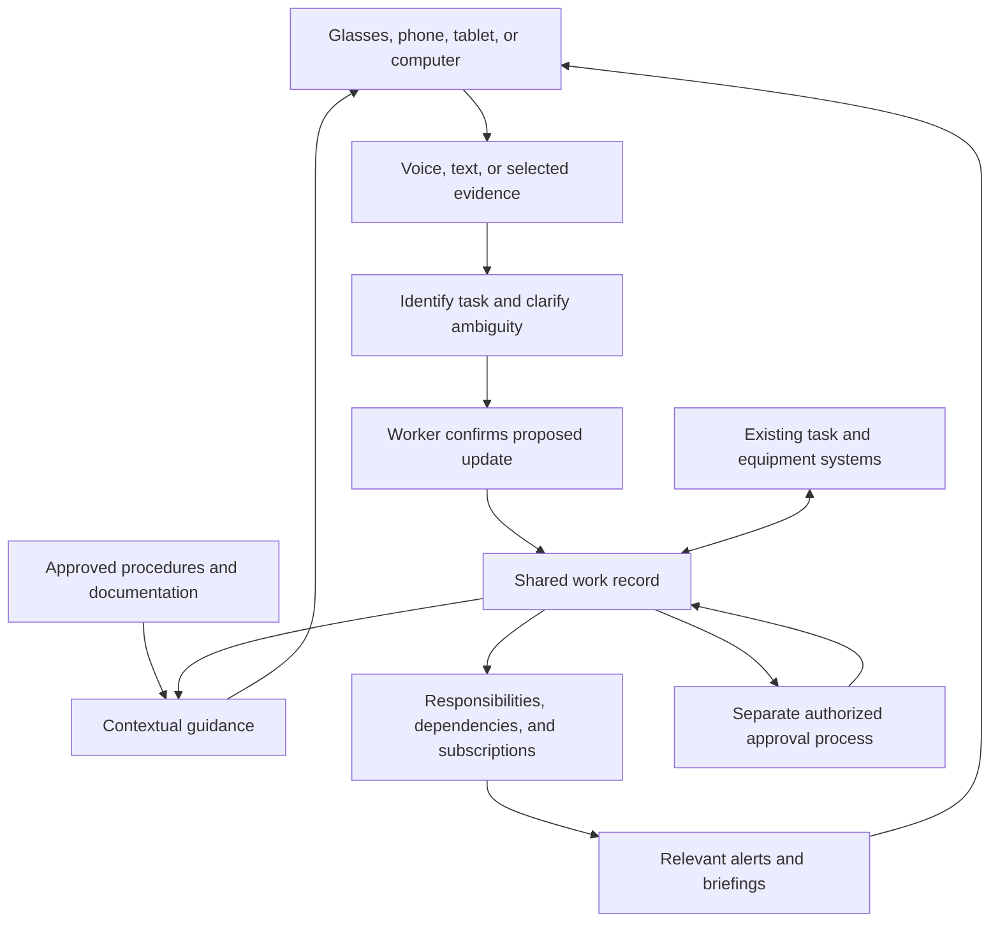

# External projects and startup ideas

**Owner:** Mohammed Bukhari

**Updated:** October 24, 2026 (America/Los_Angeles)

**Source:** Mohammed's discussion with the assistant; this document preserves
the ideas, corrections, and recommendations from that discussion, including
the YC request for startups supplied by the user.

> **FINAL SELECTED IDEA — EXT-001 / V10:** A connected-workforce operating
> system for physical projects. It connects workers, AI agents, task state,
> equipment, and procedures; captures confirmed work updates; coordinates
> dependencies and handoffs; and provides contextual guidance. Supported
> wearable interfaces and eventual robot integrations extend the system.
> Mohammed selected this direction on October 24, 2026. V1–V9 are the
> historical ideas that led here, not competing final choices.

This is the editable home for external project concepts. These are exploratory
plans, not additions to the [experience bank](bank/experience-bank.md).
“Final” identifies the selected direction; first customer, workflow, and
implementation details remain subject to discovery. No
working product, customer, paid pilot, revenue, funding, measured performance,
or flight qualification is established for the concept below.

## Project index

| ID | Project | Current stage | Latest direction |
| --- | --- | --- | --- |
| EXT-001 | Connected-workforce operating system | V10 selected; concept and customer-discovery planning | Shared work infrastructure for people and AI agents, with wearable inputs, confirmed task context, relevant coordination, guidance, and future robot interfaces. |

The versions below belong to one evolving idea family. They are not separate
companies or completed projects. Add future unrelated ideas as separate entries.

## Navigation

- [Final selected idea: V10](#latest-concept)
- [Alignment with the YC request](#alignment-with-the-yc-request)
- [Customer discovery and implementation guides](#customer-discovery-and-implementation-guides)
- [Founder motivation](#founder-motivation)
- [Evolution and alternative versions](#evolution-and-alternative-versions)
- [The three functions](#the-three-functions)
- [How the latest version would work](#how-the-latest-version-would-work)
- [Proposed information model and architecture](#proposed-information-model-and-architecture)
- [Where it could serve people](#where-it-could-serve-people)
- [Space applications](#space-applications)
- [Market entry and business hypotheses](#market-entry-and-business-hypotheses)
- [Prototype and validation plan](#prototype-and-validation-plan)
- [Laundry experiment and available hardware](#laundry-experiment-and-available-hardware)
- [Technology growth and learning path](#technology-growth-and-learning-path)
- [References and competitive context](#references-and-competitive-context)
- [Concept-stage pitch](#concept-stage-pitch)
- [Decisions and open questions](#decisions-and-open-questions)
- [Instructions for the next assistant](#instructions-for-the-next-assistant)

## Latest concept

### V10 is the final selected direction

**An operating system for physical work: a shared AI teammate that connects
people and agents to the tasks, equipment, procedures, and decisions needed
to complete work together.**

Mohammed wants connected infrastructure behind workers on large projects
that depend on frequent communication. It should help people understand the
work, maintain useful shared context, identify specific mistakes or missing
prerequisites, improve performance, and prevent avoidable problems. These are
intended outcomes that require task-specific validation.

People have profiles, responsibilities, expertise, and tasks. Regular voice,
text, or system-generated updates maintain a shared record. The system
clarifies uncertain information, confirms material changes, and delivers
relevant information to the people whose work depends on it. Supported
wearable cameras or instrument outputs can add context when useful.

The chosen direction extends beyond reporting into bounded coordination:
identify missing prerequisites, retrieve applicable procedures, prepare a
handoff, route an issue, and preserve the result. People retain required
technical decisions and approvals. Robot interfaces are a future extension
when a real customer workflow calls for them.

The proposed experience combines:

1. **Help me do my work:** explain procedures, answer questions, and help me
   understand the equipment or situation in front of me.
2. **Keep my team informed:** capture progress, problems, equipment status,
   and handoff notes with minimal interruption to the work.
3. **Tell me what affects my work:** surface changed prerequisites, blockers,
   equipment availability, requests, and decisions relevant to my responsibilities.

Glasses could be a useful interface for people working with their hands.
Phones, tablets, and computers could access the same system. A supervisor does
not need to wear glasses to receive a useful overview or respond to a question.

The recommended first implementation is a complete, narrow update-and-handoff
loop, with bounded agent assistance. Broader visual monitoring, personalized
tutoring, site-wide deployment, and robotics can follow evidence of value.
The exact sequence, first buyer, and technology stack remain unconfirmed.

Construction workers, construction managers, and Professor Mark Shami are
Mohammed's planned discovery interviewees. He describes the professor as
having megaproject experience; no additional credentials are inferred here.
Interviews are planned, not completed. Construction is a discovery focus,
not yet a validated market selection. The space application remains a
long-term user requirement.

### What is established versus proposed

| Category | Status |
| --- | --- |
| User's interests | Human augmentation, smart glasses, multidisciplinary work, combining existing technologies, and an eventual space application. |
| Selected direction | V10: connected-workforce infrastructure for physical projects, aligned with the user-supplied YC thesis; human/agent coordination, wearable interaction, contextual guidance, and future robot interfaces. |
| Shared work model | Profiles, responsibilities, tasks, regular updates, dependencies, and relevant information delivery. |
| Discovery plan | Interview workers, managers, and the user's professor about recent incidents, consequences, existing responses, and purchasing authority. No completed interviews established. |
| Earlier ideas to preserve | V1–V9 are historical precursors and possible components; they are not equally selected alternatives. |
| Assistant recommendations | Function ordering, initial markets, architecture, pilot design, and commercial models in this document. |
| Unknown | Product name, founding team, first buyer, budget, pricing, selected integrations, production hardware access, implementation progress, and validated demand. |

## Alignment with the YC request

**Reference:** Charlie Warren, “New Operating Systems for the Physical World,”
in [Y Combinator's requests for startups](https://www.ycombinator.com/rfs);
[video supplied by the user](https://www.youtube.com/watch?v=V_gDce8hBrg).
The basis for this mapping is the passage Mohammed pasted into the discussion.
It is not a fresh verification of the page or an indication of YC endorsement.

| Theme in the supplied YC request | How the selected idea addresses it | What must still be proved |
| --- | --- | --- |
| Software for work away from desks | Voice, wearable, phone, and computer interfaces share task and equipment context. | The interface reduces effort in the actual work environment. |
| Humans and AI agents working together | Agents prepare records, retrieve procedures, identify missing information, and route issues within defined authority. | Correct actions, useful time savings, and clear human oversight. |
| Routing work across different participants | Model task ownership, prerequisites, capabilities, and approval authority; assign or propose the next action accordingly. | Reliable routing in one real workflow; later robot interfaces need separate implementation. |
| Operational safety and reliability | Distinguish observations, proposals, confirmed facts, and approvals; evaluate specific errors and missed prerequisites. | Task-level evidence; no claim that camera observation certifies work or eliminates mistakes. |
| Valuable records of how work happens | Connect the task and equipment to the procedure revision, action, evidence, correction, and outcome. | Permission to use the data, adequate quality, and demonstrated product improvement. |
| Value beyond visibility alone | Follow a bounded workflow through preparation, blockers, handoff, and recorded outcome. | A buyer who values the operational improvement enough to pay. |

The passage's workforce and labor-spending figures are not independently
verified market-sizing evidence for this company. A connection to the thesis
does not establish an application, acceptance, funding, or a customer.

### Product edges to sharpen through discovery

1. Choose one recurring workflow and an identifiable owner, such as a site
   handoff or test preparation. Keep these examples open until interviews
   reveal a consequential problem.
2. Measure the consequence: waiting, rework, idle equipment, delayed approval,
   or lost context. General enthusiasm about communication is weak evidence.
3. Reduce the burden of updates through existing system events, short voice
   inputs, and exception reports. A database requiring constant manual upkeep
   may fail in real use.
4. Give agents bounded responsibilities and explicit permission checks.
   Preserve technical review and approved operating procedures.
5. Start mistake prevention with testable issues: an outdated procedure,
   incomplete prerequisite, conflicting reservation, or missed handoff.
6. Build useful work records with evidence and outcomes. Video volume alone
   does not establish a defensible data advantage.

## Customer discovery and implementation guides

These are supporting guides for the selected V10 direction. This file remains
the master for the idea and its decisions; the guides hold detailed working material.

| Guide | Use it for |
| --- | --- |
| [Customer discovery](external-projects/EXT-001/CUSTOMER-DISCOVERY.md) | The Mom Test-inspired interview plan, worker/manager/professor questions, evidence capture, and comparing bottlenecks without leading participants. |
| [Technical learning tree](external-projects/EXT-001/LEARNING-TREE.md) | Hardware, device integration, software foundations, data layers, agents, UX, reliability, future robotics/space capabilities, and the order to learn and build. |

The technical guide distinguishes operational SQL records, event history,
file storage, derived search indexes, offline data, and analytics. The first
learning project is phone voice input → structured proposal → user confirmation
→ saved task update → relevant teammate notification. This is a proposed
build sequence; no implementation is recorded as complete.

## Founder motivation

Mohammed wants to build toward **space**, rather than aeronautics. He explicitly
asked that possible directions account for what he can learn and build next,
instead of limiting him to extensions of previous resume projects.

His strongest stated interests are:

- Smart glasses and what they enable a person to do; other wearables such as
  Fitbit and Garmin also interest him.
- Understanding how people organize and build sophisticated technical systems.
- Multidisciplinary problems that require learning and experimentation.
- Augmenting human ability, teaching practical skills, and potentially helping
  robots learn from people.
- Combining existing technology into a useful product, without requiring an
  initial breakthrough in hardware or foundation-model research.

He reports broad access to aerospace people through Berkeley, AynX, and his
network. That is a potential route to discovery interviews and observation;
it is not a list of committed customers or signed design partners.

Existing product, workflow, stakeholder-discovery, software, and aerospace
experience could help him begin. Future development would also require deeper
knowledge of human factors, sensing, technical operations, and evaluation.

## Evolution and alternative versions

V1–V9 preserve the conceptual progression. V10 is the selected direction as
of October 24, 2026 and takes precedence for future work. Earlier branches
can contribute capabilities, but should not silently replace V10. Dates for
the creation of the earlier versions remain unspecified.

### V1: Expert demonstrations for robot training

Mohammed considered a company that recruits people with practical expertise
to record their work and supplies useful data to robotics or hardware
companies. The analogy was Mercor's organization of human expertise for AI,
applied to physical activity.

Possible material includes a person's view, actions, tools, task context,
reasoning, and recovery from mistakes. The useful product would depend on a
buyer's actual training and evaluation requirements. Ordinary video does not
automatically provide robot actions, contact forces, calibration, or transferable
control policies.

This remains an optional future branch. A tutoring or coordination business
should not assume it can later sell customer recordings; capture rights,
consent, data quality, and a robotics customer's specification would need to
be established separately.

### V2: One central wearable connecting separate systems

Mohammed proposed a central piece of hardware bringing independent software
and hardware together. The underlying ambition is continuity: a person can
interact with their tools through one companion instead of repeatedly switching
interfaces and losing context.

The later software-first direction could pursue that experience through an
existing phone and glasses. A custom central device is an earlier option,
not a decided manufacturing requirement.

### V3: A wearable specialty tutor, like Clicky in the physical world

The user referenced Clicky's on-screen tutoring experience and asked about
an equivalent for real-world activity. Experts such as plumbers could record
their work and explain why they make decisions. A learner would then have a
companion for that specialty while performing a task.

The important content is more than a successful demonstration: what the expert
noticed, why a step mattered, what alternatives were considered, and how to
recover when something differs. Trades, laboratories, equipment maintenance,
and technical training were possible applications.

### V4: A tutor assembled from online knowledge

Mohammed also wanted a person to ask how to do something, answer a few
clarifying questions, and receive organized guidance from applicable videos,
tutorials, manuals, and other resources. His example was dealing with a car
wheel problem and receiving help relevant to the actual situation.

The proposed process is to identify the task and equipment, select suitable
sources, reconcile conflicting instructions, and organize a usable procedure
with explanations. Guidance should retain its source and applicability rather
than treating every online tutorial as authoritative.

He described downloading the knowledge into the glasses. A practical
implementation could cache permitted source material or reviewed instructions
on the phone or local computer, with glasses handling interaction. Arbitrary
video downloading, offline rights, and enough on-device compute are not assumed.

### V5: Software that works through existing glasses

The user asked whether he could build the software and integrate it into
another company's hardware. This avoids making custom hardware a prerequisite
for exploring the product.

Possible components are camera input, audio interaction, optional displays,
phone processing, and a local or cloud backend. Device features, SDK access,
commercial distribution rights, battery life, and licensing vary by platform.
Public source code is not proof that every underlying SDK or service permits
unrestricted distribution.

### V6: A persistent personal apprenticeship system

The discussion expanded from answering a question about a frame to remembering
an ongoing activity. A useful tutor could track confirmed steps, resume after
interruptions, explain recurring mistakes, and adapt to the learner's progress.

Future improvements in perception could reduce manual confirmation. Better
spatial tracking and displays could attach guidance to the relevant object.
Improved local compute could reduce latency and network dependence. These are
future enablers, not capabilities already demonstrated by this project.

The enduring assets could include reviewed procedures, task variations,
expert reasoning, examples of failure and recovery, and evidence about how
people learn. Their value still needs to be measured.

### V7: Technical-equipment tutoring with a route to space

After Mohammed emphasized an eventual space application, the assistant
recommended technical-equipment training as one possible first market:
setup, calibration, troubleshooting, test preparation, and scientific
procedures. A manufacturer could help customers learn its equipment.

This produced the earlier concept-stage investor pitch: a wearable tutor
that makes an expert's knowledge available during physical work, starting
with one equipment family and eventually supporting unfamiliar payload
operations in space.

That market was a recommendation, not a user-validated customer decision.
Tutoring is preserved as a capability within V10; this earlier standalone
positioning is historical rather than a second selected company direction.

### V8: Wearables across a site, with shared coordination

Mohammed then asked whether everyone on a site could wear a device, receive
feedback, and remain informed about the team's work. He referenced **Perimeter,
the wildfire/emergency-response company**, as the coordination analogy.

The resulting concept joins personal assistance with shared operational
information: who is working on which equipment, what has changed, what is
blocked, and which people need an update. Perimeter's current feature set
was not verified; no claim is made that it provides this wearable architecture.

### V9: Profiles, responsibilities, tasks, and relevant updates

This was the shared-record version preceding V10. Everyone has an identity in the
system, their responsibilities and work are recorded, and regular updates
maintain a shared database. People receive relevant information through
their roles, dependencies, and chosen interests.

The three functions remain connected, but reliable reporting and handoffs
were recommended as the first commercial function. The product can begin
with deliberate voice or text updates; continuous visual understanding is
not required for every useful interaction.

### V10: Connected-workforce operating system — selected

Mohammed selected the connected-workforce direction after relating it to
YC's “New Operating Systems for the Physical World” request, planning
construction/megaproject discovery interviews, and reviewing a technical
learning tree. V10 joins the earlier shared record with contextual guidance,
bounded agent responsibilities, and coordination of real physical workflows.
Future robot participation and space use remain part of the expansion vision.

The authoritative definition is [the final selected idea](#latest-concept).
The [YC mapping](#alignment-with-the-yc-request), [discovery guide](external-projects/EXT-001/CUSTOMER-DISCOVERY.md),
and [learning tree](external-projects/EXT-001/LEARNING-TREE.md) explain how to
develop it without treating untested assumptions as established facts.

## The three functions

| Function | What it provides | Example | Current product recommendation |
| --- | --- | --- | --- |
| Help me do my work | Procedure explanations, contextual questions, troubleshooting support, and learning. | “Why does this calibration step matter?” | A narrow document-grounded assistant is an accessible demo. Reliable visual coaching and technical judgment need deeper evaluation. |
| Keep my team informed | Confirmed progress, blockers, equipment status, questions, and handoff records. | “Installation is finished; calibration is waiting on a replacement.” | Strongest proposed first commercial function: bounded input and measurable reporting/handoff value. |
| Tell me what affects my work | Relevant changes, prerequisite updates, requests, and escalation to responsible people. | “Your prerequisite has changed; review the new status before starting.” | Build on accurate shared information and agreed notification rules. |

The user clarified that his question about the most promising option concerned
these **functions**, after the assistant initially compared industries. Keep
function selection separate from customer-market selection.

The recommended sequence is **capture reliable updates → coordinate the team
→ deepen task guidance**. It is a hypothesis to test. The first function is
often easiest to demonstrate; that does not establish it as easiest to sell.

Profiles, tasks, status updates, and notifications already exist in common
work-management tools. The proposed differentiation is reduced effort during
physical work, accurate connection of updates to equipment and procedures,
useful handoffs, and relevant routing. A pilot must show an improvement over
the customer's current tools and ordinary voice notes.

### Additional value within the selected idea

- Preserve experienced workers' reasoning for later reviewed training.
- Help new people learn in the context of actual equipment and tasks.
- Keep progress, decisions, and unresolved issues intact across shifts.
- Flag competing requirements for shared equipment, parts, or specialists.
- Give remote experts a question with the relevant evidence and procedure.
- Make research easier to reproduce through configurations, revisions,
  deviations, and linked results.
- Identify recurring confusion and propose procedure improvements for review.
- Help people reconstruct where they stopped after interruptions.

These are possible extensions of the three functions. They are not all
requirements for the first release, and their benefits have not been measured.

## How the latest version would work

### Joining a team

A person signs in and creates or confirms a profile: team, role, responsibilities,
expertise, and assigned work. Administrators or existing systems may supply
these details. The person can follow additional projects or equipment and
choose how routine updates arrive.

Responsibilities and authority should be explicit. Knowing a topic does not
automatically give someone permission to approve an operation. Following a
project does not automatically grant access to restricted information.

### Contributing an update

1. A person speaks, types, or attaches a relevant image or instrument result.
2. The assistant identifies the likely task, equipment, and procedure context.
3. It asks about ambiguous details and proposes a structured update.
4. The person confirms material status changes. Separate approvals follow
   the team's actual authorization process.
5. The update is saved with its source, time, evidence, and confirmation state.
6. Relevant people receive an alert, a digest entry, or an updated status view.

Repeated submissions should not silently create duplicate progress events.
Corrections should preserve the history and update affected recipients.

### Example: a sensor installation handoff

An engineer says: “I finished installing the sensor. Calibration is waiting
on the replacement reference unit. I expect to finish tomorrow.”

The assistant clarifies the task and equipment, preserves “tomorrow” as the
person's estimate, and proposes an update. After confirmation:

| Recipient | Relevant information |
| --- | --- |
| Test operator | Calibration is blocked; the dependent test's prerequisite is incomplete. |
| Equipment owner | The team needs the replacement reference unit. |
| Team lead | The blocker and estimated impact appear in the progress briefing. |
| Person following the project | The update appears in their chosen routine digest. |
| Next shift | The handoff contains completed work, unresolved questions, and who owns the next action. |

When the replacement arrives, its availability can be reported and confirmed.
The system can notify affected people; it must not silently treat availability
as completed calibration or operational approval.

### Bounded agent work and future robot participation

In an initial implementation, agents could prepare structured records, retrieve
the applicable documentation, surface missing information, assemble a handoff,
and route issues through agreed rules. Permissions and application code would
control actions; model-generated text would not itself authorize a change.

The work model should represent who can perform a task, which prerequisites
apply, what evidence indicates completion, and who can approve it. This can
support later allocation to a person, agent, or supported robot. An actual
robot integration would additionally need a defined interface, its permitted
operating scope, trustworthy status, failure handling, and local operational
controls. None is implemented or assumed available today.

For discovery, a construction handoff is another useful example: an incoming
crew needs current information about completed work, open issues, access,
equipment, and required inspections. The system could assemble that context
and route unresolved questions. The interview must establish which information
actually causes delays and who is authorized to release the next work stage.

### Questions people could ask

- What changed since my last shift?
- What is blocking my work, and who owns the next action?
- Which of my prerequisites are still incomplete?
- What does the team need from me?
- Who has relevant expertise in this subsystem?
- What was the reason for this decision, and where is the source?
- Which procedure revision applies to this equipment?
- Walk me through the next approved step.

Answers should show the relevant source and last-confirmed time. “No recent
update” must remain distinguishable from “nothing has changed.”

### Keeping notifications useful

Use both role-required notifications and voluntary subscriptions. A worker
may need to know about a changed prerequisite even without following the
whole project. A project follower may prefer a daily summary.

Group related updates, suppress duplicates, and let people correct routing.
Agree which updates deserve immediate delivery or acknowledgment. Notification
sent, seen, acknowledged, and acted upon are different states.

## Proposed information model and architecture

This is a design sketch, not an implemented schema or selected technology stack.

| Record | Information it would need |
| --- | --- |
| Person | Stable identity, team, role, expertise, responsibilities, permissions. |
| Agent | Identity, accountable owner, permitted actions, data-access scope, and approval requirements. |
| Task | Owner, scope, equipment, status, deadline or estimate, blocker, last confirmation. |
| Dependency | Which task or condition depends on another, and who confirms it. |
| Equipment | Identifier, location where relevant, configuration, availability, associated procedures. |
| Procedure | Approved source, revision, applicability, steps, prerequisites, and completion evidence. |
| Update | Author, time, task/equipment links, original input, proposed structured fields, confirmation. |
| Evidence | Relevant photo, note, instrument result, document reference, and access controls. |
| Approval | Authorized reviewer, exact decision, scope, timestamp, and required record. |
| Subscription | Person, followed project/topic/equipment, and access scope. |
| Notification | Trigger, intended recipient, reason, delivery preference, and acknowledgment state. |



The proposed starting architecture connects to existing task systems instead
of requiring a customer to migrate every record. Decide which system owns
each field, how updates synchronize, and how conflicting or offline edits
are reconciled. An AI-generated summary is a derived view, not a substitute
for the authoritative record.

Keep camera observations, inferred interpretations, confirmed work updates,
and formal approvals distinct. A camera cannot independently verify hidden
connections, torque, electrical performance, or flight readiness. Readings
need an actual instrument source or explicit human entry.

Recording controls, permitted visibility, retention, and customer data ownership
are product requirements for a shared workplace system. Initial capture can
be deliberate and task-specific; always-on recording is not a prerequisite.

## Where it could serve people

| Setting | Useful work | Potential buyer or sponsor | What remains to test |
| --- | --- | --- | --- |
| Construction and megaproject teams | Crew handoffs, prerequisite tracking, issue routing, shared-equipment coordination, and relevant field updates. | Contractor, site/project manager, or another process owner identified through discovery. | Which recurring bottleneck is consequential, who can change it, and whether software addresses its actual cause. |
| Technical laboratories | Equipment setup, experiment handoffs, troubleshooting explanations, and operator training. | Lab manager, equipment owner, or manufacturer. | Whether repeated teaching and missing context create enough cost to justify purchase. |
| Manufacturing and integration | Progress capture, questions, blocked tasks, and cross-shift handoffs. | Operations, manufacturing, or test manager. | Fit with existing manufacturing/quality systems and actual update effort. |
| Field service and skilled trades | Job notes, remote expert questions, task guidance, and dispatch coordination. | Service organization or equipment supplier. | Worksite connectivity, recurring procedures, and adoption in real conditions. |
| Equipment manufacturers | Customer training and support grounded in specific products and revisions. | Training, service, or customer-support leadership. | Documentation access, distribution agreement, and measured support outcomes. |
| Emergency response | Shared situational information and relevant coordination. | Response organization or public agency. | Procurement, connectivity, authority, and reliability requirements; not the recommended first deployment. |
| Individual everyday learning | Household tasks and personal instruction. | Consumer; no validated payment model. | Whether guidance is reliable, useful often enough, and worth paying for. |

The shared-team version is especially relevant when people have occupied hands,
move between equipment, or lose context across shifts. Fully desk-based teams
may get less distinctive value from a wearable interface.

## Space applications

Space-related work on Earth offers a way to develop the product without
requiring an initial flight deployment. These are proposed uses, not verified
open contracts or evidence that a particular organization will buy.

| Application | How the three functions could help | Potential entry point | Readiness boundary |
| --- | --- | --- | --- |
| Payload and spacecraft test benches | Explain setup; capture configuration and blockers; notify the next operator of confirmed readiness prerequisites. | Commercial payload developer, independent test lab, or university lab. | Begin with a recurring ground procedure and training hardware. |
| Satellite assembly and integration | Teach visible steps; preserve questions and handoffs; route issues to the responsible engineer and reviewer. | Manufacturing or assembly, integration, and test team. | Must fit configuration control, quality records, and existing approvals. |
| Scientific payload preparation | Capture a scientist's reasoning; rehearse procedures; communicate configuration changes to later operators. | Research team, payload integrator, or instrument supplier. | Each experiment may be unique; repetition and budget need validation. |
| Ground-station equipment work | Guide approved troubleshooting; record service work; coordinate equipment availability across teams or locations. | Ground-station operator or equipment supplier. | Depends on documentation access, connectivity, and equipment permissions. |
| Crew and analog-mission training | Teach unfamiliar tasks; test interruption recovery; share confirmed progress between participants and instructors. | Training provider or research program. | A useful evaluation setting; participation alone does not establish a scalable market. |
| Onboard scientific operations | Provide locally available procedure guidance; maintain task state; share updates with crew and ground when connectivity permits. | Future mission operator or payload program. | Requires separate mission, hardware, security, operational, and human-factors validation. |
| Future onboard maintenance and exploration work | Preserve local expertise, support handoffs, and assist crews with delayed ground communication. | Future crewed mission program. | Longer-term extension; no autonomous repair, EVA suitability, or flight readiness established. |

### Concrete ground-based space scenario

A technician preparing a payload sees a connector label that differs from
the procedure. They flag it with an image and the relevant step. The responsible
engineer receives the context; the test operator sees a pending prerequisite;
the team lead sees a blocker. Once the issue has been reviewed through the
existing approval process, the resolution and correct procedure reach the
people who need them.

The same interaction can teach the technician why the discrepancy mattered
and preserve that explanation for future reviewed training material. It does
not treat a plausible visual match as proof of a safe or correct connection.

### Route toward onboard use

One possible progression is ground equipment training and handoffs, then
payload-procedure rehearsal and crew training, followed by separately validated
onboard assistance. Offline procedure availability, synchronized records,
clear timestamps, and interruption recovery become especially relevant when
ground support is delayed or unavailable.

Ground adoption must have its own value. An eventual space application does
not establish current demand or justify bypassing mission-specific validation.

## Market entry and business hypotheses

Two different questions were discussed: which function to build first and
which customer group to approach. The latest function recommendation is
confirmed progress/handoff capture. The suggested space-related market is
a team with recurring payload or test-equipment work.

**Current discovery focus:** Mohammed plans interviews with construction
workers, construction managers, and his professor with user-reported megaproject
experience. These conversations should reveal the first consequential
workflow. The earlier payload/testing recommendation remains an option to
compare, not a settled first market or a reason to steer construction interviews.

| Option | Why consider it | Main limitation | Suggested role |
| --- | --- | --- | --- |
| Construction and megaproject teams | The user's planned interviews can expose concrete incidents across workers, managers, and contractor boundaries. | No findings, purchasing authority, or paid demand established yet. | Current discovery focus; first workflow and customer remain open. |
| Berkeley payload/CubeSat team | Potential access, technical work, and a place to observe real handoffs. | Limited budgets and interest may not translate into payment. | Early design and evaluation partner. |
| Commercial payload team or independent testing lab | Recurring procedures, identifiable engineering manager, and measurable time spent clarifying work. | Actual repetition, urgency, data access, and purchasing ability are unverified. | Proposed first paying-customer hypothesis. |
| Technical-equipment manufacturer | Could distribute training/support software with a specific equipment family to many customers. | Requires product-specific evidence and a commercial partnership. | Proposed expansion and distribution route. |
| Site-wide spacecraft operations | Broader coordination value across teams. | More integrations, stakeholders, and approval requirements. | Expand after proving a bounded workflow. |
| Wildfire response or onboard crew operations | Important coordination and knowledge needs. | Additional operational and procurement/qualification complexity. | Preserve as possible future applications. |

Potential commercial arrangements include a paid team pilot, an annual team
or site subscription, and manufacturer-distributed software. No price, sales
cycle, market size, revenue forecast, or committed buyer has been established.
Do not combine hardware sales, subscriptions, and robotics-data sales into a
claimed business model before validating one primary customer and use case.

The first purchase hypothesis is straightforward: a manager may pay to reduce
the time spent chasing updates, repeated explanations, missing handoff context,
and avoidable delays. The initial discovery work must determine whether those
costs are real and whether the proposed assistant improves them.

## Prototype and validation plan

This is a proposed plan, not authorization to begin implementation or contact
people. The requested work for this document is documentation and publication.

### First pilot: one team, one recurring task, one handoff

Observe how the team currently performs and records a recurring task. Identify
the people who provide information, the people who depend on it, and the
system already used for status and approvals.

A minimal prototype could include:

- Sign-in, profiles, explicit responsibilities, and a small set of tasks.
- Voice or text updates with a review/confirmation step.
- Task ownership, dependencies, blockers, and last-confirmed timestamps.
- A shared status view, concise handoff briefing, and a small number of agreed alerts.
- A link to the authoritative task system or a clearly designated pilot record.
- Optional questions answered from a small, reviewed procedure collection.

Phones and a web interface could validate this workflow before integrating
glasses. A later comparison should establish whether glasses reduce effort
enough to justify their setup, comfort, and device constraints.

### Evidence to collect

| Question | Useful measurement |
| --- | --- |
| Is updating easier? | Time and interruptions required to record a useful update. |
| Is the record trustworthy? | Missing or stale statuses, incorrect extraction, corrections, and source traceability. |
| Are handoffs better? | Missing context, clarification requests, and time spent reconstructing prior work. |
| Are notifications useful? | Relevant versus unnecessary alerts, missed important updates, and acknowledgment burden. |
| Does work improve? | Observed delays, setup errors, and expert involvement on the selected task. |
| Does tutoring teach? | Correct completion and later performance with less assistance. |
| Is there commercial demand? | Willingness to commit staff time, documentation, a budget owner, and a paid evaluation. |

Establish a baseline and agree acceptance criteria with the partner before
the pilot. No target percentage or successful outcome is assumed. A demo
that answers questions is not evidence that the system improves teamwork.

### Expansion only after evidence

After useful update capture, add dependency-based routing and relevant
briefings. Then consider visual context, deeper tutoring, equipment integrations,
and wider site coverage. Revisit which feature creates value rather than
following the original sequence automatically.

## Laundry experiment and available hardware

The user proposed laundry as an accessible demonstration of a companion
observing physical activity and explaining a possible mistake.

**Confirmed equipment and preferences:** Mohammed owns Meta glasses and a
Raspberry Pi 5. He had not bought a camera. The glasses model and phone operating
system remain unspecified. He wanted warnings and explanations, not control
of the washing machine. He explicitly redirected the assistant from coding
a starter to explaining the connections; no completed prototype is established.

The example goal was to notice white and colored clothes being combined and
the user selecting hot water, then explain what to check or change. A useful
first experiment would record deliberate additions and removals, keep a load
history, and ask for uncertain details.

Two proposed connection routes were:

```text
USB camera → Raspberry Pi 5 → local/cloud vision processing
                                ↓
                              phone → glasses audio

Supported glasses camera → phone app → optional Pi/local/cloud processing
                              ↑                       ↓
                         glasses audio ← explanation
```

The Pi is optional when the phone and backend handle the work. A supported
developer camera API is needed for the glasses route; ordinary Bluetooth
pairing does not grant access to the camera. The phone would need an app to
receive results and provide the intended audio interaction.

A 1080p autofocus USB webcam compatible with Linux/UVC and a stable mount was
suggested as a simple external-camera option. No model, purchase, or tested
compatibility is established.

Visible color alone does not establish dye stability, fabric composition, or
care requirements. The system must distinguish a selected washer setting from
a printed label and cannot reconstruct hidden laundry perfectly. It should
use clothing care information and confirmations rather than assuming whites
always require hot water. This experiment tests perception, task memory, and
feedback; it does not validate an enterprise market or safety-critical guidance.

## Technology growth and learning path

The full [technical learning tree](external-projects/EXT-001/LEARNING-TREE.md)
is the implementation-learning companion for V10. It marks NOW, NEXT, and
LATER topics and includes the first complete interaction and a staged build
sequence. Its architecture and stack suggestions remain adaptable to discovery.

The user's question was partly about what to build now that becomes more
capable as wearable technology improves. The proposed strategy is to develop
useful task representations and evaluations with today's deliberate inputs,
then reduce friction as sensing improves.

| Useful capability to develop now | Future improvement that could help | Value to test |
| --- | --- | --- |
| Confirmed task state and interruption recovery | More reliable understanding of actions over time | Fewer manual confirmations without losing accuracy. |
| Procedures with prerequisites, explanations, and completion evidence | Better object tracking and spatial displays | Guidance attached to the relevant component. |
| Personal learning history | Better recognition of when someone needs help | More effective instruction and retained skills. |
| Relevant routing from team responsibilities and dependencies | Better integration and contextual understanding | Fewer missed changes and unnecessary alerts. |
| Reviewed expert demonstrations and recovery examples | Better video understanding; possibly buyer-specific robotics use | More useful teaching material, with rights and quality established. |
| Local procedure cache and synchronization | More capable on-device compute and power efficiency | Useful assistance when connectivity is limited. |

A learning path for Mohammed could include mobile/wearable interfaces,
audio and visual perception, retrieval from versioned technical documentation,
event-based task state, integrations, human-computer interaction, and evaluation
with real operators. Space-related expansion adds configuration management,
assembly/test practice, human factors, and mission constraints.

The project should remain useful if future model or hardware improvements
arrive more slowly than expected. Better generic assistants could also replace
a thin application; domain-specific evidence and demonstrated outcomes need
to justify the product.

## References and competitive context

These links preserve reference points discussed earlier. They were **not
freshly verified for this document**, are not a complete market study, and do
not prove a current product's customers, capabilities, shipping availability,
pricing, or commercial terms. Recheck official documentation and licenses
before choosing a platform or making a competitor claim.

| Reference | Why it was relevant | Important qualification |
| --- | --- | --- |
| [Clicky](https://github.com/farzaa/clicky) | User's analogy: contextual tutoring on a computer, extended to real-world work. | Earlier public code is a reference; later private product work was not inspected. |
| [Brilliant Labs SDK](https://github.com/brilliantlabsAR/brilliant_sdk) and [Noa app](https://github.com/brilliantlabsAR/noa-flutter) | Third-party software on existing glasses through a host application. | Earlier review found permissive code licenses; Frame and Halo capabilities differ. Frame audio output needs a phone or other output device. Recheck hardware/app availability. |
| [MentraOS](https://github.com/Mentra-Community/MentraOS) | Wearable platform, host software, and integrations. | Earlier review found a discrepancy between broad store messaging and SDK-specific distribution documentation. Do not assume the current MiniApp SDK has a supported public store route. |
| [Meta Wearables DAT for iOS](https://github.com/facebook/meta-wearables-dat-ios) and [Android](https://github.com/facebook/meta-wearables-dat-android) | Potential camera/audio access through a phone application for supported glasses. | Previously described as developer preview with model, firmware, feature, and publishing restrictions. Separate Meta terms apply; public examples do not establish unrestricted commercial use. |
| [OpenVision](https://github.com/rayl15/OpenVision) | Reference for a voice/vision application using existing glasses. | Earlier review found an MIT application license; underlying SDK and provider terms still apply. No task-verification or tutoring-outcome claims were established. |
| [VisionClaw](https://github.com/Intent-Lab/VisionClaw) | Reference for glasses vision, live interaction, and optional agent tools. | A prior broad “open source” description was corrected: the root license pointed to Meta developer terms. Do not assume MIT-style unrestricted reuse. |
| [RealWear Collaborate](https://github.com/realwear/collaborate) and [Vuzix](https://github.com/Vuzix) | Existing approaches to hands-free collaboration and wearable interfaces. | Demos, SDKs, and collaboration products do not establish a complete equivalent to this proposed tutor/team system. |
| Perimeter, wildfire/emergency response | User's analogy for shared awareness and coordination. | Current product details could not be verified from accessible sources; avoid specific feature or wearable claims. |
| [Ropedia](https://github.com/Ropedia) and [Lightwheel](https://github.com/LightwheelAI/LW-Egosuite-DevKit) | Reference points for the physical-expertise data branch. | Earlier public descriptions discussed human demonstrations and capture tools; no customer, payment, or revenue claims were established here. |
| [Universal Manipulation Interface](https://github.com/real-stanford/universal_manipulation_interface) | Research reference for human demonstrations supporting robot learning. | Research feasibility in a particular setup does not establish general transfer from arbitrary wearable video. |

NASA/ESA pages were inaccessible during earlier research attempts. The space
use cases here are product hypotheses, not a verified inventory of current
agency deployments or procurement opportunities.

Potential alternatives customers may already use include manuals, instructor
support, chat, task trackers, digital work instructions, and remote expert
assistance. Evaluate against the actual customer baseline. Do not claim no
competition, exclusive capabilities, or a defensible data advantage without
evidence, data rights, and measured value.

## Concept-stage pitch

The following is proposed positioning, not a claim that the product is built
or that customers have adopted it:

> Our concept is an operating system for physical work that connects workers
> and AI agents through shared, confirmed task context. It helps teams understand
> what is ready, what is blocked, and who owns the next action, while preserving
> the procedures and approvals needed to carry out the work.
>
> A worker can report a blocker through glasses or a phone. The assistant
> connects the update to the right task and equipment, clarifies uncertain
> details, and prepares a record for confirmation. Agents retrieve applicable
> instructions and route missing information; the next person receives a
> useful handoff. Supervisors can see the decisions that need their attention.
>
> We will use discovery with construction workers, managers, and experienced
> project practitioners to identify one recurring workflow with an expensive
> failure or delay. The first pilot would measure reporting effort, missing
> context, incorrect alerts, handoff quality, and the operational outcome.
> The first paying market has not yet been selected.
>
> Over time, the same work model could connect supported robots and provide
> more contextual technical guidance. The long-term ambition includes space
> teams and crews operating unfamiliar equipment with limited immediate
> support, with separate validation for onboard use.

The earlier tutor-focused positioning remains useful for that variant:
“Turn an expert's demonstration and approved documentation into guidance
someone can use while performing the work.” Neither pitch establishes funding,
market size, existing traction, or a final commercial strategy.

## Decisions and open questions

### Preserve these user choices

- Explore a meaningful eventual space application.
- Build on what Mohammed can learn, not only what he has already done.
- Prioritize what wearables enable people to do and learn.
- Explore software combining existing technology and hardware platforms.
- Treat V10, the connected-workforce operating system aligned with the supplied
  YC request, as the final selected direction as of October 24, 2026.
- Retain shared profiles, responsibilities, tasks, confirmed updates, relevant
  coordination, and contextual help as the product foundation.
- Use the planned construction/manager/professor interviews to investigate
  bottlenecks. Do not treat them as completed research or a fixed first market.
- In the laundry example, warn and explain; do not control the washer.
- Preserve V1–V9 as history and possible component ideas; do not present them
  as equally selected alternatives unless Mohammed explicitly reopens the direction.

### Recommendations that still need validation

- Start with confirmed update capture and handoffs, then relevant coordination.
- Choose one recurring technical workflow before expanding across a site.
- Use an accessible lab for learning and seek commercial willingness to pay early.
- Compare the earlier commercial payload/testing hypothesis with problems
  uncovered in construction discovery; equipment manufacturers remain a
  possible distribution route.
- Integrate with an existing work system when that reduces adoption effort.
- Test the workflow through phones/computers before making glasses mandatory.

### Questions for the next discovery work

1. Who repeatedly waits for whose information, and what happens when it is late?
2. Which task recurs often enough to support a useful evaluation and purchase?
3. What does the team use today for task state, procedures, equipment, and approvals?
4. Which updates could be captured by voice, and which require instrument or reviewer evidence?
5. Which people need immediate alerts, and which prefer summaries?
6. Who owns the budget, and what outcome would justify a paid pilot?
7. What recordings and documents can the team provide, and under what rights?
8. Does wearable capture improve the workflow enough compared with a phone or existing chat?
9. Which Meta glasses model and phone OS does Mohammed have, and what SDK/distribution access is available?
10. Which platform can meet the actual workflow's battery, connectivity, audio, display, and privacy requirements?
11. What would disprove the proposed first market or function ordering?

Do not repeatedly ask broad “what do you want to do?” questions. The interests
and direction above are already established. Ask concrete questions about
people, work, evidence, and constraints as the project progresses.

## Instructions for the next assistant

Read [AGENTS.md](AGENTS.md) for repository operating rules. For this concept,
use this file as the working source; no earlier chat is required.

- Update this Markdown file directly. It is not a generated bank or tracker view.
- Start from V10 as the selected direction. The historical tutor, standalone
  data-supply, and custom-hardware concepts are not the current default.
- Use the linked customer-discovery and learning guides for detailed work.
  Keep the master decision status here; avoid contradictory copies in the guides.
- Preserve stable project/version IDs, user decisions, open questions, and the
  distinction between user statements and assistant recommendations.
- Incorporate later corrections into the current concept; retain useful older
  branches and explain what changed instead of treating all versions as simultaneous requirements.
- Keep proposed capabilities in conditional or future terms until implementation
  and evaluation evidence exists. Record actual artifacts or results separately.
- Recheck current SDK access, commercial licenses, hardware features, and competitor
  claims before using them for implementation or external pitches.
- A concept is not resume evidence. Add accomplishments to the bank only after
  the user supplies concrete work and its scope is recorded through the normal bank workflow.
- No new application, sent message, interview, or job event follows from this
  document. Keep application tracking separate.
- Documentation does not authorize building a prototype, contacting partners,
  collecting workplace recordings, or buying hardware. Follow the current user request.
- Keep the repository entry links current. Check Markdown links, anchors,
  factual scope, and the diff before publishing authorized changes to GitHub.

### Change record

| Date | Change | Evidence |
| --- | --- | --- |
| 2026-10-22 | Created EXT-001 with the idea's evolution, latest shared-team concept, proposed architecture, use cases, space applications, market hypotheses, prototype notes, and continuation instructions. | User discussion and explicit request to document the ideas in GitHub; no new implementation or customer evidence. |
| 2026-10-24 | Marked V10 as the final selected connected-workforce operating-system direction; added the user-supplied YC alignment, bounded agent work, additional use cases, planned construction discovery, and linked interview and technical-learning guides. Retained V1–V9 as history and kept market/platform choices open. | User explicitly requested the final idea be distinguished and aligned with the YC request; selection is confirmed, implementation and demand are not. |
